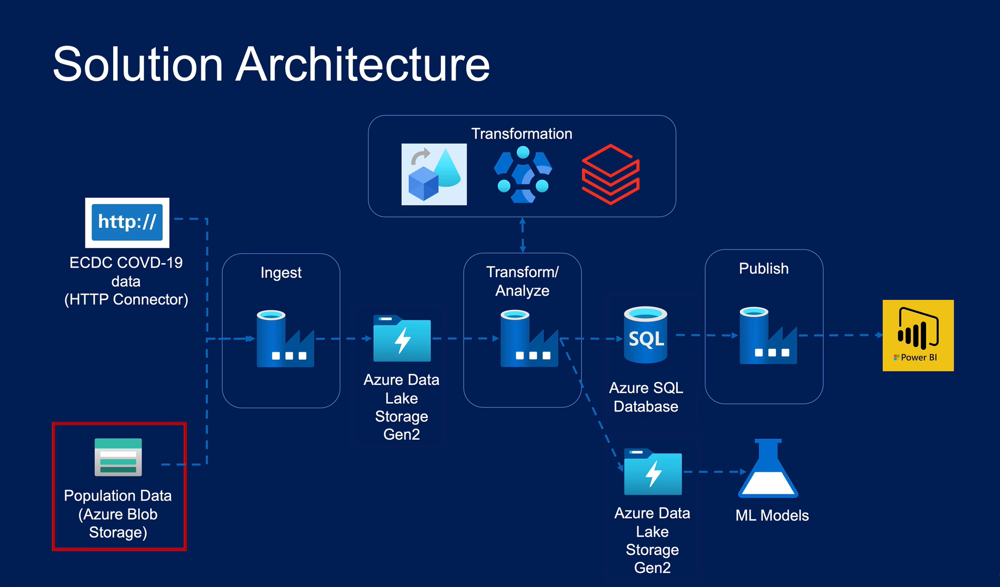
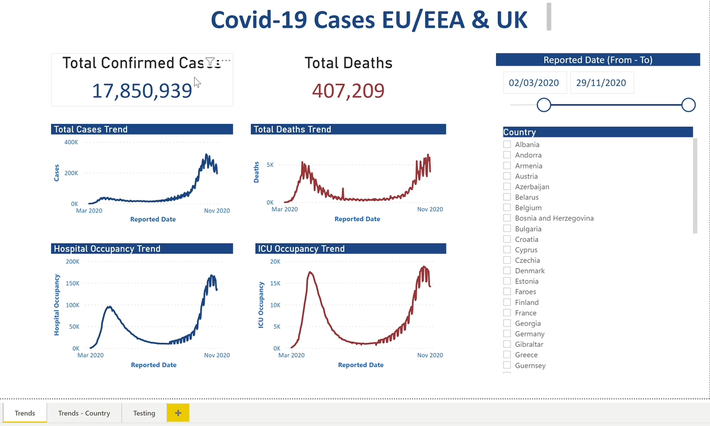
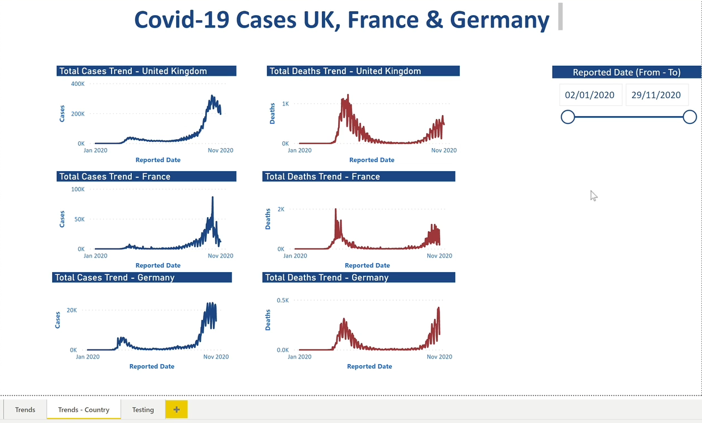
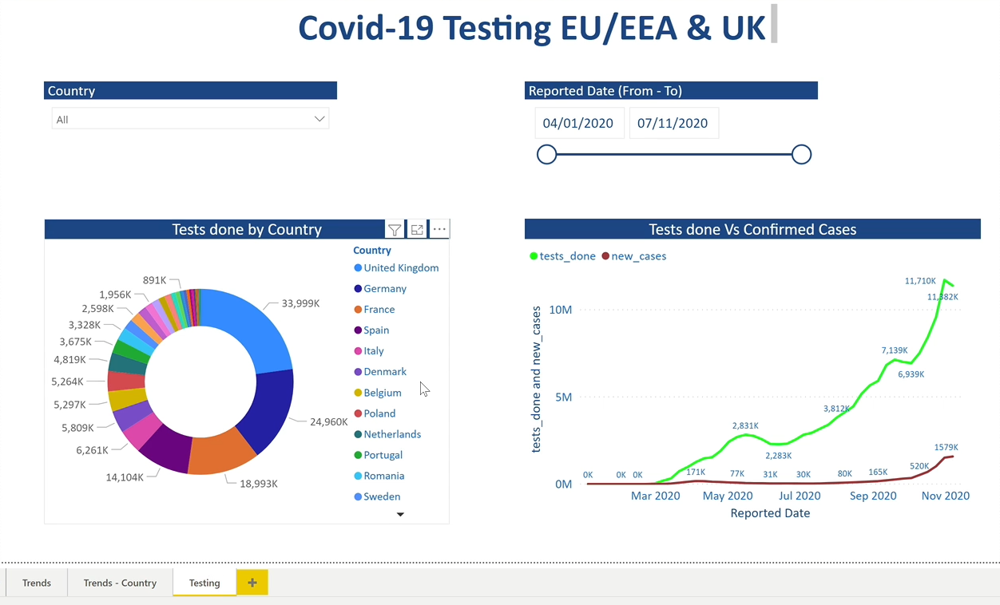

<div align="center">

# ☁️ PandemicVision – End-to-End Data Intelligence Platform

### Building a Scalable Cloud Data Engineering & Analytics Solution Using Microsoft Azure

<p>
  
  
  
  
  
</p>

**Data Ingestion | Data Lake | ETL/ELT | Big Data Processing | Business Intelligence**

</div>

---

## 📌 Table of Contents

1. [Project Overview](#-project-overview)
2. [Business Problem](#-business-problem)
3. [Proposed Solution](#-proposed-solution)
4. [Project Objectives](#-project-objectives)
5. [Technology Stack](#-technology-stack)
6. [Data Sources](#-data-sources)
7. [System Architecture](#-system-architecture)
8. [Detailed Implementation](#-detailed-implementation)
9. [End-to-End Pipeline Workflow](#-end-to-end-pipeline-workflow)
10. [Data Lake Architecture](#-data-lake-architecture)
11. [Data Transformation](#-data-transformation)
12. [Azure SQL Database](#-azure-sql-database)
13. [Power BI Dashboard](#-power-bi-dashboard)
14. [Key Business Metrics](#-key-business-metrics)
15. [Challenges and Solutions](#-challenges-and-solutions)
16. [Key Learnings](#-key-learnings)
17. [Future Enhancements](#-future-enhancements)
18. [Project Repository Structure](#-project-repository-structure)
19. [Conclusion](#-conclusion)

---

## 🚀 Project Overview

The **PandemicVision – End-to-End Data Intelligence Platform** is a cloud-based data engineering project designed to demonstrate how modern Microsoft Azure services can be integrated to build a scalable, automated, and analytics-ready data platform.

The project integrates COVID-19 public health data from the European Centre for Disease Prevention and Control (ECDC) with population reference data stored in Azure Blob Storage.

Using Microsoft Azure's data engineering ecosystem, the solution automates the complete data lifecycle — from source ingestion and raw data storage to advanced transformations, relational data serving, and interactive business intelligence reporting.

The pipeline leverages:

- Azure Data Factory (ADF)
- Azure Data Lake Storage Gen2 (ADLS Gen2)
- Azure Databricks
- Azure HDInsight
- Azure SQL Database
- Microsoft Power BI

The final output is a collection of curated datasets and interactive dashboards that enable stakeholders to monitor COVID-19 trends, compare countries, and analyze population-adjusted health metrics.

### 🎯 Project Goal

To transform fragmented raw datasets into reliable, structured, and meaningful business insights through an integrated Azure data engineering workflow.

---

## 💼 Business Problem

Public health organizations, researchers, and business stakeholders require timely and accurate information to understand the spread and impact of COVID-19.

However, the required information is distributed across multiple systems and data sources.

COVID-19 statistics are available through external APIs, while population reference datasets are stored separately in cloud storage.

Combining these datasets manually introduces several challenges:

- **Data Fragmentation:** Information is distributed across multiple sources and formats.
- **Manual Data Processing:** Extracting, cleaning, and integrating datasets is time-consuming.
- **Data Inconsistency:** Different country names, reporting dates, and data structures can affect analytical accuracy.
- **Scalability Limitations:** Traditional processing approaches may struggle with increasing data volumes.
- **Limited Analytics:** Raw datasets do not directly support population-adjusted comparisons.
- **Delayed Reporting:** Manual processing makes timely business reporting difficult.

### Business Requirements

A centralized and automated cloud data platform is required to:

1. Ingest data from multiple external and internal sources.
2. Store raw datasets in scalable cloud storage.
3. Perform data cleansing and transformation.
4. Enrich COVID-19 statistics with population information.
5. Calculate meaningful analytical metrics.
6. Publish curated datasets for reporting.
7. Support reliable and repeatable data processing.

---

## 💡 Proposed Solution

To address these challenges, this project implements an end-to-end data engineering solution using Microsoft Azure.

The architecture follows a layered data processing approach, with each Azure service performing a specific responsibility.

### Solution Highlights

- Automated ingestion using Azure Data Factory.
- Centralized storage using Azure Data Lake Storage Gen2.
- Lightweight transformations using Azure Data Factory.
- Advanced data processing using Azure Databricks and PySpark.
- SQL-based big data processing using Azure HDInsight.
- Population-based data enrichment.
- Relational data serving using Azure SQL Database.
- Interactive reporting using Microsoft Power BI.

---

## 🎯 Project Objectives

| Objective | Description |
|---|---|
| Data Ingestion | Extract data from REST APIs and cloud storage |
| Cloud Storage | Store raw and processed datasets in ADLS Gen2 |
| Data Transformation | Clean, filter, standardize, and aggregate data |
| Data Integration | Combine COVID-19 and population datasets |
| Big Data Processing | Process complex transformations using Spark |
| Data Serving | Load curated data into Azure SQL Database |
| Visualization | Build interactive Power BI dashboards |
| Scalability | Follow modular and reusable architecture patterns |

---

## 🛠 Technology Stack

| Technology | Purpose |
|---|---|
| Azure Data Factory | Data ingestion and orchestration |
| Azure Data Lake Storage Gen2 | Scalable cloud data storage |
| Azure Blob Storage | Population reference data storage |
| Azure Databricks | Advanced data processing |
| Apache Spark | Distributed data transformations |
| PySpark | Python-based Spark processing |
| Azure HDInsight | Hadoop and Hive processing |
| Hive SQL | SQL-based big data transformations |
| Azure SQL Database | Relational serving layer |
| Power BI | Interactive dashboards and reporting |
| REST API | External data integration |
| Python | Data processing and scripting |
| SQL | Data querying and analysis |

---

## 📂 Data Sources

### 1. ECDC COVID-19 Dataset

**Source:** European Centre for Disease Prevention and Control (ECDC)

The primary dataset contains COVID-19 public health statistics retrieved through a public REST API.

**Dataset information:**

- Reporting date
- Country and geographical identifiers
- Daily confirmed cases
- Daily deaths
- Cumulative statistics, where available
- Country-level reporting information

**Integration Method:** Azure Data Factory HTTP Linked Service.

Official Website: https://www.ecdc.europa.eu/

### 2. Population Reference Dataset

**Source:** Azure Blob Storage

The population dataset contains country-level demographic information used to enrich COVID-19 statistics.

**Dataset information:**

- Country name
- Country code
- Population count
- Reference year, where available

**Business Purpose:**

- Calculate cases per 100,000 people.
- Calculate deaths per 100,000 people.
- Compare infection levels across countries.
- Perform population-adjusted analysis.

**Integration Method:** Azure Data Factory Blob Storage Linked Service.

---

## 🏗 System Architecture

The project follows an end-to-end cloud data engineering architecture.

### Architecture Diagram

<!-- Replace this path with your actual architecture image -->

<p align="center">
  
</p>

### Architecture Components

| Layer | Azure Service | Responsibility |
|---|---|---|
| Data Sources | ECDC API / Blob Storage | Source datasets |
| Ingestion | Azure Data Factory | Data extraction and orchestration |
| Storage | ADLS Gen2 | Raw and processed data |
| Transformation | Azure Data Factory | Lightweight transformations |
| Transformation | Azure Databricks | Advanced Spark processing |
| Transformation | Azure HDInsight | Hive SQL processing |
| Serving | Azure SQL Database | Curated relational datasets |
| Visualization | Power BI | Interactive reporting |

---

## ⚙️ Detailed Implementation

### 1. Data Ingestion – Azure Data Factory

Azure Data Factory acts as the central orchestration and ingestion engine.

**Implementation:**

- Created an HTTP Linked Service to connect to the ECDC REST API.
- Configured a Blob Storage Linked Service to access population data.
- Created source and destination datasets.
- Implemented Copy Activities to transfer source data.
- Configured pipeline execution and scheduling.
- Used ADF monitoring to track execution status.

**Key Components:**

| Component | Responsibility |
|---|---|
| HTTP Linked Service | Connect to ECDC API |
| Blob Linked Service | Access population files |
| Copy Activity | Move source data |
| Pipeline | Orchestrate ingestion |
| Trigger | Automate execution |
| Monitoring | Track pipeline execution |


### 2. Data Storage – ADLS Gen2

Azure Data Lake Storage Gen2 acts as the centralized storage platform.

All source datasets are initially stored in their original format, preserving source fidelity and supporting historical reprocessing.

**Key Features:**

- Scalable cloud storage.
- Hierarchical namespace.
- Integration with Azure Databricks.
- Support for structured and semi-structured data.
- Centralized data management.

The storage architecture follows the Bronze, Silver, and Gold data lake pattern.

### 3. Lightweight Transformation – Azure Data Factory

ADF Mapping Data Flows and Copy Activities are used for basic data transformations.

**Transformation activities:**

- Column selection.
- Column renaming.
- Schema mapping.
- Filtering unwanted records.
- Basic data cleansing.
- Simple aggregations.

### 4. Advanced Transformation – Azure Databricks

Azure Databricks is responsible for compute-intensive transformations using Apache Spark.

**Major responsibilities:**

1. Read raw COVID-19 data from ADLS Gen2.
2. Load population reference datasets.
3. Clean and standardize records.
4. Normalize country identifiers.
5. Join COVID-19 data with population data.
6. Calculate population-adjusted metrics.
7. Perform daily and country-level aggregations.
8. Write curated datasets back to the data lake.

### 5. SQL-Based Processing – Azure HDInsight

Azure HDInsight provides managed Hadoop and Hive capabilities.

**Responsibilities:**

- Query data lake files using Hive SQL.
- Perform filtering and aggregations.
- Execute batch processing workloads.
- Transform datasets stored in the data lake.
- Support SQL-based big data processing.

### 6. Data Serving – Azure SQL Database

After transformation, curated datasets are loaded into Azure SQL Database.

**Responsibilities:**

- Create structured relational tables.
- Define appropriate data types and schemas.
- Load transformed datasets.
- Store country-level and date-level statistics.
- Optimize tables and indexes for reporting.
- Provide a data connection for Power BI.

### 7. Business Intelligence – Power BI

Power BI connects to Azure SQL Database to provide interactive dashboards.

**Dashboard capabilities:**

- Daily confirmed cases and deaths.
- Cumulative COVID-19 trends.
- Country-wise case comparisons.
- Death statistics by country.
- Population-adjusted infection rates.
- Geographical analysis.
- Date-based trend analysis.

---

## 🔄 End-to-End Pipeline Workflow

The complete pipeline follows this execution sequence:

```text
       ┌──────────────────────────────┐
       │        DATA SOURCES          │
       │                              │
       │       ECDC REST API          │
       │     Population Dataset      │
       └──────────────┬───────────────┘
                      │
                      ▼
       ┌──────────────────────────────┐
       │     AZURE DATA FACTORY       │
       │                              │
       │   HTTP + Blob Linked Service │
       │        Copy Activities       │
       └──────────────┬───────────────┘
                      │
                      ▼
       ┌──────────────────────────────┐
       │        ADLS GEN2             │
       │                              │
       │        BRONZE LAYER          │
       │         Raw Data             │
       └──────────────┬───────────────┘
                      │
                      ▼
       ┌──────────────────────────────┐
       │     TRANSFORMATION LAYER     │
       │                              │
       │  Azure Data Factory          │
       │  Azure Databricks            │
       │  Azure HDInsight             │
       └──────────────┬───────────────┘
                      │
                      ▼
       ┌──────────────────────────────┐
       │        ADLS GEN2             │
       │                              │
       │     SILVER + GOLD LAYER      │
       │   Cleaned & Curated Data     │
       └──────────────┬───────────────┘
                      │
                      ▼
       ┌──────────────────────────────┐
       │     AZURE SQL DATABASE       │
       │                              │
       │     Relational Serving       │
       └──────────────┬───────────────┘
                      │
                      ▼
       ┌──────────────────────────────┐
       │          POWER BI            │
       │                              │
       │    Interactive Dashboards    │
       └──────────────────────────────┘
```

---

## 🥉 Data Lake Architecture

The project follows the Medallion Architecture to organize datasets into three logical layers.

### 🟤 Bronze Layer – Raw Data

Stores the original datasets ingested from source systems.

**Contents:**

- Raw COVID-19 API responses.
- Population reference files.
- Historical source snapshots.

**Purpose:** Preserve source data and support historical reprocessing.

### ⚪ Silver Layer – Cleaned Data

Stores standardized and cleansed datasets.

**Processing activities:**

- Data type standardization.
- Missing value handling.
- Country name normalization.
- Duplicate removal.
- Schema validation.
- Data cleansing.

**Purpose:** Improve data quality and consistency.

### 🟡 Gold Layer – Curated Data

Stores business-ready datasets.

**Contents:**

- COVID-19 and population enriched datasets.
- Aggregated country-level metrics.
- Daily and cumulative statistics.
- Population-adjusted KPIs.

**Purpose:** Provide analytics-ready data for downstream reporting.

---

## 🧮 Data Transformation

One of the key requirements of this project is enriching COVID-19 statistics with population reference data.

### Population-Adjusted Calculations

**Cases per 100,000 population**

\[
Cases\ per\ 100K =
\frac{Confirmed\ Cases}{Population}
\times 100,000
\]

**Deaths per 100,000 population**

\[
Deaths\ per\ 100K =
\frac{Total\ Deaths}{Population}
\times 100,000
\]

### Example PySpark Transformation

```python
from pyspark.sql.functions import col

# Load COVID-19 dataset
covid_df = spark.read.parquet(
    "/mnt/datalake/silver/covid/"
)

# Load population dataset
population_df = spark.read.parquet(
    "/mnt/datalake/silver/population/"
)

# Join datasets using country identifier
enriched_df = covid_df.join(
    population_df,
    on="country_code",
    how="inner"
)

# Calculate population-adjusted metrics
result_df = (
    enriched_df
    .withColumn(
        "cases_per_100k",
        (col("cases") / col("population")) * 100000
    )
    .withColumn(
        "deaths_per_100k",
        (col("deaths") / col("population")) * 100000
    )
)

# Save curated dataset
result_df.write.mode("overwrite").parquet(
    "/mnt/datalake/gold/covid_enriched/"
)
```

*Note: This is illustrative PySpark logic. Adapt the column names and storage paths to match the actual datasets.*

---

## 🗄 Azure SQL Database

Azure SQL Database serves as the final relational layer.

### Suggested Database Schema

| Table | Description |
|---|---|
| DimCountry | Country and geographical information |
| DimDate | Calendar and reporting dates |
| FactCovidCases | Daily COVID-19 statistics |
| FactPopulation | Population reference data |
| FactCovidAnalytics | Enriched analytical metrics |

The database provides structured datasets for Power BI reporting.

---

## 📊 Power BI Dashboard

Power BI is used to create interactive dashboards based on the curated Azure SQL datasets.

### Dashboard Features

- Total confirmed cases.
- Total reported deaths.
- Daily infection trends.
- Country-level comparisons.
- Population-adjusted metrics.
- Geographical distribution.
- Date-based filtering.

### Dashboard Screenshots

<!-- Add your actual Power BI screenshots below -->

<p align="center">
  
</p>

<p align="center">
  
</p>

<p align="center">
  
</p>

<p align="center">
  <em>COVID-19 Analytics Dashboard – Power BI</em>
</p>

---

## 📈 Key Business Metrics

| KPI | Business Purpose |
|---|---|
| Daily Cases | Monitor newly reported infections |
| Total Cases | Understand cumulative reported infections |
| Daily Deaths | Monitor daily fatalities |
| Total Deaths | Understand cumulative reported fatalities |
| Cases per 100K | Compare infection levels relative to population |
| Deaths per 100K | Compare population-adjusted mortality |
| Country Comparison | Identify geographical differences |
| Daily Trends | Analyze changes over time |

*Recovery statistics should only be included if reliable recovery data is available in the source dataset.*

---

## ⚠️ Challenges and Solutions

| Challenge | Engineering Approach |
|---|---|
| Different source formats | Standardize schemas and data types |
| Country name inconsistencies | Normalize country identifiers |
| Missing records | Apply data validation and cleansing |
| Large transformations | Use distributed Spark processing |
| Duplicate records | Implement deduplication |
| Data integration | Use consistent relational keys |
| Reporting performance | Optimize SQL tables and queries |

---

## 📚 Key Learnings

This project demonstrates practical experience with:

1. Building automated ETL pipelines using Azure Data Factory.
2. Designing cloud data lakes using ADLS Gen2.
3. Implementing Bronze, Silver, and Gold data layers.
4. Performing distributed transformations using PySpark.
5. Using Hive SQL for big data processing.
6. Integrating multiple datasets using relational joins.
7. Designing analytical serving layers using Azure SQL.
8. Connecting cloud data platforms with Power BI.
9. Selecting appropriate Azure services for different workloads.
10. Building modular and reusable data processing workflows.

---

## 🔮 Future Enhancements

The architecture can be extended with additional enterprise-grade capabilities.

| Enhancement | Expected Benefit |
|---|---|
| Incremental Data Loading | Reduce unnecessary processing |
| Data Quality Framework | Improve reliability |
| Automated Validation | Detect missing and invalid records |
| CI/CD Integration | Improve deployment management |
| Infrastructure as Code | Automate Azure resource provisioning |
| Centralized Monitoring | Improve pipeline observability |
| Delta Lake | Support ACID transactions |
| Machine Learning | Enable predictive trend analysis |
| Role-Based Access Control | Improve data security |

---

## 📁 Project Repository Structure

```text
Azure-COVID19-Data-Engineering/
│
├── README.md
│
├── architecture/
│   ├── azure_architecture.png
│   └── adf_pipeline.png
│
├── data/
│   ├── raw/
│   └── population/
│
├── azure-data-factory/
│   ├── pipelines/
│   ├── datasets/
│   └── linked-services/
│
├── databricks/
│   └── notebooks/
│
├── hdinsight/
│   └── hive_queries/
│
├── sql/
│   ├── schema/
│   └── scripts/
│
├── power-bi-dashboard/
│   └── covid_dashboard.png
│
└── docs/
    └── implementation_notes.md
```

*This is a suggested repository structure. Include only the folders and implementation artifacts that are actually available.*

---

## 🏆 Project Conclusion

The PandemicVision – End-to-End Data Intelligence Platform demonstrates how Microsoft Azure services can be integrated to develop a complete cloud-based data engineering solution.

By combining Azure Data Factory, Azure Data Lake Storage Gen2, Azure Databricks, Azure HDInsight, Azure SQL Database, and Power BI, this project establishes a structured workflow for data ingestion, storage, transformation, enrichment, and visualization.

The solution demonstrates the practical application of modern data engineering concepts, including:

- Cloud-based ETL/ELT pipelines.
- Layered data lake architecture.
- Distributed data processing.
- Multi-source data integration.
- Relational data modelling.
- Business intelligence reporting.

**This project provides a strong foundation for developing scalable cloud data platforms and demonstrates practical knowledge of the Microsoft Azure data engineering ecosystem.**

---

<div align="center">

### ⭐ If you find this project useful, consider giving it a star!

**Built with Microsoft Azure | Data Engineering | Big Data | Analytics**

</div>
